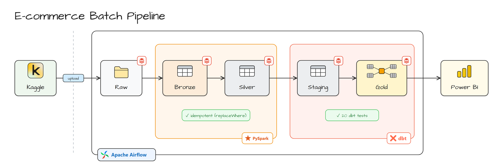

# E-commerce Batch Data Pipeline

A portfolio project: a daily batch pipeline that turns about 42 million raw e-commerce events
(Kaggle, October 2019) into tested, analytics-ready tables on Databricks. PySpark does the heavy
cleaning, dbt builds the business models, Apache Airflow runs the whole thing one date at a time,
and Power BI reads the gold layer.



## How it works

| Layer | What happens | Tool |
|---|---|---|
| **Source** | The October 2019 CSV (5.3 GB, 42,448,764 rows) is split into one file per date under `data/landing/date=YYYY-MM-DD/` | pandas |
| **Raw** | Each date's file is uploaded to the Unity Catalog Volume `/Volumes/ecommerce/raw/landing/events/` | Databricks SDK |
| **Bronze** | `bronze.events`: every column kept as string, plus `event_date`, `_ingested_at`, `_source_file` | PySpark |
| **Silver** | `silver.events`: typed columns, UTC timestamps, duplicates dropped, zero prices flagged, `category_code` split into two levels | PySpark |
| **Staging** | `stg_events` view: empty brand and category filled with `(unknown)` so every gold model treats them the same | dbt |
| **Gold** | `dim_products` plus four fact and mart tables | dbt |
| **Serving** | Gold tables imported into a four-page report (screenshots in `dashboard/powerbi/`) | Power BI |

Bronze and silver are Delta tables partitioned by `event_date`, written by the Databricks Job
`ecommerce_bronze_silver` (two notebook tasks, one `run_date` parameter). dbt runs against a
Databricks SQL warehouse.

### Gold models

| Model | Grain | Materialization |
|---|---|---|
| `dim_products` | one row per product | table |
| `fct_daily_sales` | one row per date | incremental, merge on `event_date` |
| `fct_daily_funnel` | one row per date | incremental, merge on `event_date` |
| `fct_hourly_activity` | one row per date and hour | incremental, merge on `event_date`, `event_hour` |
| `mart_top_products` | one row per week and product | incremental, merge on `week_start`, `product_id` |

`mart_top_products` has a weekly grain but runs daily, so each run recomputes the whole current
week (Monday up to `run_date`). Merging a single day would overwrite the week's row with one day
of data.

### Orchestration

The Airflow DAG `ecommerce_daily` processes one date per run:

```
check_landing_file → upload_to_volume → run_spark_job → dbt_build → log_run_summary
```

- `check_landing_file` fails fast, with no retries, when the local file for that date is missing.
- `upload_to_volume` uploads through `databricks-sdk`, then compares the local and Volume file sizes.
- `run_spark_job` triggers the Databricks Job with `DatabricksRunNowOperator`, passing `run_date`.
- `dbt_build` runs `dbt build --vars '{run_date: <date>}'`, so models and tests run together. dbt
  lives in its own virtualenv inside the Airflow image to keep its dependencies away from Airflow's.
- `log_run_summary` writes row counts per layer to `ops.pipeline_runs` and fails if bronze or
  silver came out empty.

The dataset is historical, so daily arrival is simulated with a backfill: `start_date` 2019-10-01,
`end_date` 2019-10-11, `schedule="@daily"`, `catchup=True`. `max_active_runs=1` because
Databricks Free Edition has a single small SQL warehouse. Tasks retry twice with a 5-minute delay.

### Idempotency

Re-running a date replaces that date's data instead of adding to it:

- `upload_to_volume` overwrites the file in the Volume.
- Bronze and silver are written with Delta `replaceWhere event_date = '<run_date>'`, so only that
  partition is replaced.
- Fact models are incremental with a `unique_key`, so dbt merges the date's rows.
- `log_run_summary` deletes the date's row in `ops.pipeline_runs` before inserting it again.

Tested by re-running 2019-10-03 end to end, including the 144 MB re-upload:

```
before : bronze 1,127,303   silver 1,126,624
after  : bronze 1,127,303   silver 1,126,624
rows in ops.pipeline_runs for 2019-10-03 : 1
```

### Data quality

`dbt build` runs 20 tests on every run:

- `not_null` and `unique` on gold keys, with singular tests for the composite grains of
  `fct_hourly_activity` and `mart_top_products`
- `accepted_values` on `event_type` (`view`, `cart`, `purchase`)
- `relationships` from `stg_events` and `mart_top_products` to `dim_products`
- A singular test that daily revenue is never negative

The silver notebook also asserts that every `event_time` parsed. Issues found in the raw data and
how the pipeline handles them:

| Issue | How common | Handling |
|---|---|---|
| Empty `category_code` | ~32% of rows | Filled with `(unknown)` in `stg_events` |
| Empty `brand` | ~15% of rows | Filled with `(unknown)` in `stg_events` |
| Price 0 | ~0.17% of rows | Flagged `is_price_zero` in silver, excluded from revenue, rows kept |
| Duplicate rows | ~0.06% of rows | Dropped in silver on `event_time`, `event_type`, `product_id`, `user_id`, `user_session` |
| Missing `cart` events | 60% of purchase sessions | Counted per day in `fct_daily_funnel.sessions_purchase_no_cart` instead of hidden |

Rows with an empty brand or category are kept rather than dropped, so revenue totals stay the
same across every table.

## Results

First 7 runs of the backfill (2019-10-01 to 2019-10-07), all green:

| | |
|---|---:|
| Bronze rows | 8,829,315 |
| Silver rows after dedup | 8,823,603 |
| Duplicates dropped | 5,712 (0.065%) |
| Raw CSV | 1.10 GB |
| Delta bronze | 0.14 GB (8.1x smaller) |
| Delta silver | 0.25 GB (4.5x smaller) |
| Run time per date (5 tasks) | 3m40s to 4m05s |
| `dbt build` per run | PASS=26 (6 models + 20 tests) |

`fct_hourly_activity` holds exactly 168 rows (7 days x 24 hours), and its event total matches
the silver row count. Bronze is smaller than silver despite having more rows: all-string columns
compress very well under Parquet dictionary encoding, while silver adds typed and derived columns.

The backfill was then extended to 2019-10-11 by raising `end_date`. Dates already processed were
not touched.

## Design choices

- **No intermediate database.** Raw data is files, so it goes straight from the laptop to a
  Volume. Loading 42 million rows into Postgres first would add a slow step with no benefit.
- **Upload from the laptop.** Free Edition limits outbound internet from notebooks, so Databricks
  cannot pull from Kaggle directly.
- **Compute stays in Databricks.** Spark and dbt both run there. The laptop only holds landing
  files and runs Airflow.
- **PySpark and dbt split the work.** PySpark handles volume and cleaning. dbt owns the business
  logic and its tests.

## Tech stack

- **Apache Airflow 3.4** with LocalExecutor and PostgreSQL, run on Docker Compose
- **Databricks Free Edition**: Unity Catalog `ecommerce`, Volumes, Delta Lake, Jobs, SQL warehouse
- **PySpark** for bronze and silver
- **dbt-core** + **dbt-databricks** for staging, gold, and tests
- **Power BI Desktop**, saved as a Power BI Project (PBIP) in `powerbi/`
- **Data**: [eCommerce Behavior Data from Multi Category Store](https://www.kaggle.com/datasets/mkechinov/ecommerce-behavior-data-from-multi-category-store) (REES46) on Kaggle
